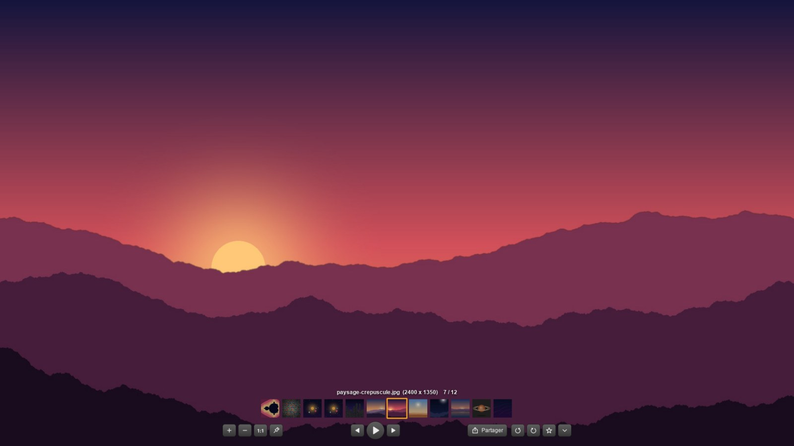
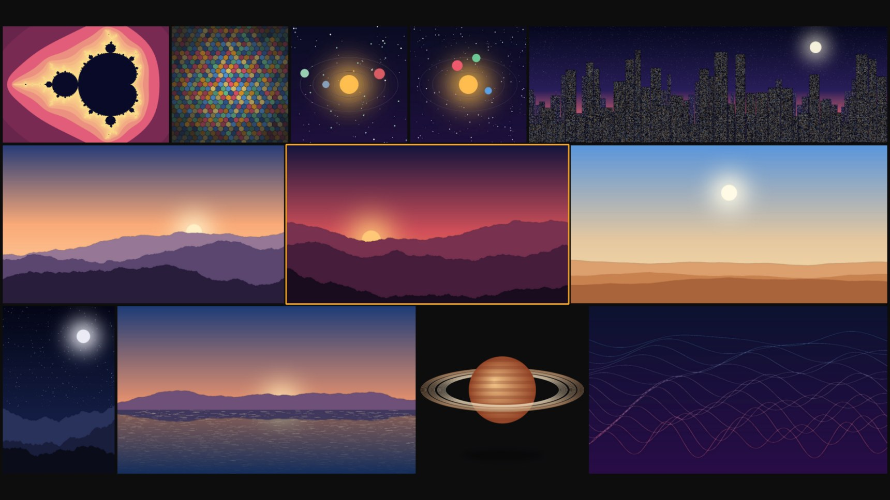

# 36Frame

Liseuse d'images pour **Windows et Linux**, inspirée de Picasa : photos (JPEG, PNG, BMP, TIFF…),
**GIF et WebP animés**, AVIF/PSD via Pillow. La vidéo est prévue (voir plus bas).

Python 3 + PySide6 (Qt 6). En français, réalisé avec Claude.

👉 **Page de présentation : https://36txxnxtrgxgsh.github.io/36Frame/**

## Présentation

Pour essayer : ouvrez le dossier [`exemples/`](exemples/) avec 36Frame (images dessinées par programme,
domaine public). Les captures ci-dessus ont été faites avec ces images.

## Télécharger

Dans la page **Releases** du dépôt GitHub :

| Fichier | Pour qui |
|---|---|
| `36Frame-Setup-<version>.exe` | Windows 10/11 64 bits — installation sans droits administrateur |
| `36Frame-Portable-rapide.zip` | Windows, sans installation (à décompresser ; recommandé en portable) |
| `36Frame-Portable.exe` | Windows, un seul fichier (plus lent : se décompresse à chaque lancement) |

L'exécutable n'est pas signé numériquement : au premier lancement, Windows peut afficher « Windows a
protégé votre ordinateur » → *Informations complémentaires* → *Exécuter quand même*.

**Confidentialité** : 36Frame ne se connecte jamais à Internet. Réglages, favoris (chemins de vos images)
et miniatures restent sur votre PC (`%APPDATA%\36Frame`, `%LOCALAPPDATA%\36Frame\miniatures`, ou le dossier
`36Frame-donnees` à côté de l'exe en version portable).

Composants tiers et licences : [THIRD_PARTY_NOTICES.md](THIRD_PARTY_NOTICES.md).

## Installer (Windows)

`dist\36Frame-Setup-<version>.exe` : installe 36Frame sans droits administrateur et le déclare comme
visionneuse d'images. À la fin, la page « Applications par défaut » s'ouvre : cliquer sur
**Définir par défaut** (Windows interdit à un programme de le faire lui-même).
Pour refabriquer l'installateur : `powershell -ExecutionPolicy Bypass -File compiler.ps1`.

## Lancer depuis les sources

Prérequis : **Python 3.10 ou plus récent** (testé avec 3.14), Windows 10/11 ou Linux. Les dépendances
(versions figées) sont dans `requirements.txt` ; pour fabriquer les exécutables :
`requirements-compilation.txt` + [Inno Setup 6](https://jrsoftware.org/isinfo.php) (Windows).

| | |
|---|---|
| Windows | `demarrer.bat` (glisser une image dessus pour l'ouvrir) ou `.venv\Scripts\pythonw.exe lancer.pyw <image>` |
| Linux | `./demarrer.sh <image>` (crée l'environnement au premier lancement) |
| Première installation Windows | `installer.bat` |

Sans argument, 36Frame demande : **une image** ou **un ou plusieurs dossiers**. Les dossiers se choisissent
dans la fenêtre « Sélectionner un dossier » de Windows, **plusieurs à la fois** (Ctrl+clic, Maj+clic, Ctrl+A ;
aussi `Ctrl+Maj+O` ou menu ▾). Pour réunir des dossiers de disques différents : menu ▾ > « Composer une
sélection de dossiers », qui accepte autant de dossiers qu'on veut (bouton « Ajouter », ou
glisser-déposer depuis l'Explorateur ; « Reprendre la dernière sélection ») ; glisser plusieurs dossiers sur
la liseuse fait de même. Toutes leurs images **et celles de leurs sous-dossiers** sont réunies, dans l'ordre
de l'Explorateur (un dossier déjà contenu dans un autre de la liste n'est pas compté deux fois) ; navigation, miniatures, diaporama et Mosaïque Dossier portent sur l'ensemble, et le nom
affiché indique le dossier et le sous-dossier (`Photos 2024/Vacances/Plage/photo.jpg`). Dossiers cachés et système ignorés.
Sur un très gros disque, `Échap` arrête la recherche et garde les images déjà trouvées.

## Utilisation

**Barre d'outils** (apparaît au survol du bas de la fenêtre, disparaît ensuite) :
`+` `−` `1:1` `⛶` (fenêtre ajustée à l'image) `📌` (épingler au premier plan) · `◀` `▶ diaporama` `▶` · Partager · `↺` `↻` · `★` favori · `▾` autres options.
Au-dessus : nom, dimensions, rang dans le dossier, et les **miniatures du dossier**.

| Geste | Effet |
|---|---|
| Molette sur l'image | zoom avant / arrière autour du curseur |
| Molette sur les miniatures | arrière = image suivante, avant = précédente |
| Clic sur une miniature | ouvre l'image |
| Glisser le fond (fenêtré) | déplace la fenêtre |
| Glisser l'image | déplace l'image (ou la parcourt si elle est zoomée) |
| Glisser une image qui remplit toute la fenêtre | déplace la fenêtre |
| Bords de la fenêtre | redimensionnement |
| Double-clic / F11 / Entrée | plein écran ⇄ fenêtré |
| Clic sur le fond en plein écran | retour en fenêtré |
| Clic droit | menu des options |
| Clic molette (ou Ctrl+clic) sur une miniature | ouvre l'image dans une nouvelle fenêtre |
| Clic droit sur ★ | ranger l'image dans un dossier de favoris |
| Haut à droite (survol) | réduire / plein écran / fermer |

Raccourcis : `←` `→` (aussi PgPréc/PgSuiv), `Début`/`Fin`, `+` `-`, `1` (1:1), `0` (ajuster),
`Espace` (diaporama), `Échap`, `Ctrl+L` / `Ctrl+R` (rotation), `Ctrl+D` (favori),
`Ctrl+C` (copier l'image), `Ctrl+Maj+C` (copier le fichier), `Ctrl+P`, `Ctrl+O`, `Ctrl+E` (dossier),
`Ctrl+N` (nouvelle fenêtre), `Ctrl+M` (mosaïque), `Ctrl+W` (fermer la fenêtre), `Ctrl+Q` (tout fermer).

**Zoom** : animé et progressif (12 % par cran de molette, en continu sur pavé tactile) ; une pastille
au centre indique le pourcentage de la taille réelle de l'image (100 % = 1 pixel image pour 1 pixel écran).

**Plusieurs fenêtres** : un seul 36Frame tourne ; chaque image ouverte depuis l'Explorateur arrive
dans une nouvelle fenêtre (réglable). Dès qu'il y a deux fenêtres, le bouton **Mosaïque** les dispose
toutes à l'écran : optimale (plus grande surface d'image), en lignes, en colonnes, grille, cascade
ou pêle-mêle. Une fenêtre n'est jamais agrandie au-delà de la taille réelle de son image.

**Mosaïque Dossier** (clic droit > Mosaïque Dossier, ou `Ctrl+G`) : les images du dossier en plein
écran, en rangées ajustées (proportions respectées, espace entre chaque), en commençant par l'image
ouverte. Molette arrière / avant : la suite / le début du dossier, en défilement continu et amorti
(accélère et ralentit en douceur ; « Douceur du défilement » réglable dans Configuration).
`Ctrl+molette` (ou `+` `-`) : images plus grandes ou plus petites (nombre de rangées, mémorisé).
Clic sur une image : elle s'ouvre dans la liseuse ; clic molette : nouvelle fenêtre ;
clic sur le fond ou `Échap` : retour. Seules les images visibles sont chargées, à la taille d'affichage.
Défilement **vertical** (rangées) ou **horizontal** (colonnes) : Configuration, ou clic droit dans la mosaïque.
**Panorama** : bouton en bas au centre (visible au survol) ou `Espace` : les images défilent toutes
seules ; vitesse réglable dans Configuration (secondes par écran), reprend au début si « Recommencer »
est coché. Pendant le Panorama et le diaporama, l'écran ne se met pas en veille.
Les **GIF et WebP animés s'animent** dans la mosaïque. Configuration > « Mosaïque Dossier, animations » :
toujours, **au survol de la souris** (seule l'image survolée s'anime ; toutes pendant le Panorama), ou
jamais. Chaque
animation visible est décodée une seule fois à la taille de sa tuile, et ses images gardées
compressées en mémoire (≈ 1 à 4 Mo par animation au lieu de 25 à 100 Mo) ; seules les tuiles qui
bougent sont redessinées.

**Supprimer** : touche `Suppr` (image affichée, ou image survolée dans la Mosaïque Dossier), ou clic
droit > Supprimer. L'image va dans la **corbeille** (récupérable), après confirmation (désactivable :
case « Ne plus demander » ou Configuration). La liseuse passe à l'image suivante ; les autres fenêtres,
la mosaïque et les favoris sont mis à jour.

**Dossiers de favoris** : en plus de « Favoris », on crée ses propres dossiers (menu ▾ > Favoris, ou
clic droit sur ★), chacun se parcourt comme un dossier, se vide, se renomme ou se supprime (les images
ne sont jamais supprimées). Dès qu'un dossier de favoris existe, un clic sur ★ ouvre un petit menu pour
choisir où ranger l'image (`Ctrl+D` reste l'ajout direct à « Favoris »).

**Rapidité** : ouvrir une autre image depuis l'Explorateur ne recharge pas le programme : le nouveau
lancement passe l'image à la fenêtre déjà ouverte avant même de charger Qt (~0,2 s). Le programme est
allégé de ce qu'il n'utilise jamais (68 Mo au lieu de 105). La version portable « exe unique » se
décompresse à chaque lancement (~1 s par image) : sur un PC portable, préférer
`Portable\36Frame-Portable-rapide.zip`, aussi rapide que la version installée.

**Mémoire** : le cache d'images décodées s'adapte à la RAM du PC (3 %, entre 150 et 400 Mo) ; l'image
affichée n'en est jamais chassée ; seule la voisine dans le sens de lecture est préchargée (l'autre
seulement si elle est petite) ; la Mosaïque Dossier rend sa mémoire (256 Mo max pour les images fixes,
~100 Mo pour les animations) dès qu'on la ferme ; une animation cachée (fenêtre réduite, ou derrière la
mosaïque) est mise en pause.

**Mode adaptatif** (par défaut) : la fenêtre épouse l'image — sa taille réelle, sans dépasser 90 % de
l'écran (réglable) — et se réadapte à chaque image. Molette : zoom dans la fenêtre (qui garde sa taille ;
en dézoomant sous la taille de la fenêtre, la fenêtre rétrécit avec l'image). **Ctrl+molette** : la fenêtre
et l'image grandissent / rétrécissent ensemble (zoom en cours pris en compte). Redimensionner la fenêtre à
la souris agrandit l'image, en gardant ses proportions. Pas de fond : seule l'image est visible.
La fenêtre change de taille autour de son **bas-centre** et la barre d'outils a une largeur fixe : la
barre et les miniatures **ne bougent pas** d'une image à l'autre (pratique pour enchaîner à la molette sur
les miniatures). Une petite image garde une fenêtre assez large pour toute la barre (surplus transparent).
**Mode PICASA** (Configuration > Mode d'affichage) : l'ancien comportement, fenêtre de taille fixe et fond
gris autour de l'image.

**Affichage** : une image plus petite que la zone s'affiche à sa taille d'origine (en pixels réels de
l'écran, même avec la mise à l'échelle Windows), une image plus grande est réduite pour tenir.
`1:1` bascule entre taille d'origine et ajustement. Le bouton à sa droite (ou `W`), visible quand la
fenêtre n'a pas la taille de l'image, resserre la fenêtre autour de l'image affichée (zoom conservé,
image laissée à sa place à l'écran, sans dépasser l'écran).

**Épingler au premier plan** (bouton punaise à côté de `1:1`, ou `T`) : la fenêtre reste au-dessus de
toutes les autres, y compris d'un **jeu en plein écran fenêtré / sans bordure** (« Borderless »). Un jeu en
plein écran *exclusif* ne peut être recouvert par aucune fenêtre (limite de Windows) : choisir le mode
sans bordure dans les options vidéo du jeu. L'épingle est réaffirmée chaque seconde, au cas où le jeu se
remettrait lui-même devant. Astuce : avec une image détourée, seul le sujet apparaît par-dessus le jeu.

**Images détourées** (PNG, WebP, GIF… à fond transparent) : en mode fenêtré, la fenêtre perd son fond et
seul le sujet reste visible, posé sur ce qui se trouve derrière (bureau, autres applications). La
fenêtre reste déplaçable en cliquant n'importe où. Configuration > « Images détourées » : voir derrière
(par défaut), fond de la fenêtre, ou damier. En plein écran, le fond assombri reste affiché.

**Partager** : e-mail avec pièce jointe (Outlook classique, Thunderbird, `xdg-email` sous Linux ;
sinon le fichier est copié et un message vierge s'ouvre), Discord (fichier copié + Discord ouvert,
il reste à faire Ctrl+V), copier le fichier ou l'image, afficher dans le dossier.

**Autres options** : favoris (liste, parcours de tous les favoris comme un dossier), ouvrir avec
(Paint, Photoshop, GIMP, Krita, Paint.NET… détectés automatiquement, + logiciels ajoutés, + « Autre
application… »), imprimer, configuration.

**Visionneuse par défaut (Windows)** : Configuration > « Visionneuse par défaut de Windows » (ou menu ▾) :
cocher les types d'images (27 formats : JPEG, PNG, WebP, AVIF, GIF, BMP, TIFF, ICO, PSD, TGA, SVG…),
puis « Définir 36Frame par défaut… ». 36Frame se déclare (registre de l'utilisateur, sans droits
administrateur — marche aussi avec la version portable) et ouvre Paramètres > Applications par défaut >
36Frame, où il reste à cliquer sur **Définir par défaut** : Windows interdit à un programme de le faire
seul. « Retirer » efface ces déclarations.

**Configuration** : bandeau sombre derrière la barre (désactivé par défaut), mode et marge de la mosaïque, nouvelle fenêtre par image, fond fenêtré (gris par défaut, couleur, opacité ou transparent), teinte et opacité
du fond plein écran, lissage, ombre, durée et boucle du diaporama, délai de masquage de la barre,
logiciels « Ouvrir avec ». Fichier : `%APPDATA%\36Frame\config.json` (Linux : `~/.config/36Frame/`).
Miniatures en cache dans `%LOCALAPPDATA%\36Frame\miniatures`.

La rotation est un affichage : le fichier n'est jamais modifié.

## Organisation du code

| Fichier | Rôle |
|---|---|
| `frame36/gestion.py` | instance unique, liste des fenêtres, calcul des mosaïques |
| `frame36/fenetre.py` | fenêtre sans cadre, modes fenêtré / plein écran, navigation, menus, diaporama |
| `frame36/vue.py` | dessin de l'image, zoom, déplacement, rotation, gestes souris |
| `frame36/barre.py` | barre d'outils, bande de miniatures, boutons de fenêtre |
| `frame36/chargement.py` | liste du dossier, décodage en arrière-plan, cache, miniatures |
| `frame36/actions.py` | partage, ouvrir avec, impression |
| `frame36/dialogue_config.py`, `config.py` | configuration |
| `frame36/icones.py` | icônes dessinées (aucun fichier image) |

## Vidéo (à venir)

La vue n'affiche que des `QImage`. Pour la vidéo : `QMediaPlayer` + `QVideoSink`, dont chaque
`videoFrameChanged` donne une image (`frame.toImage()`) passée à `Vue.definir_image(..., nouvelle=False)`
comme pour les GIF, plus une barre de lecture. Il faudra le paquet `PySide6-Addons` (QtMultimedia).
